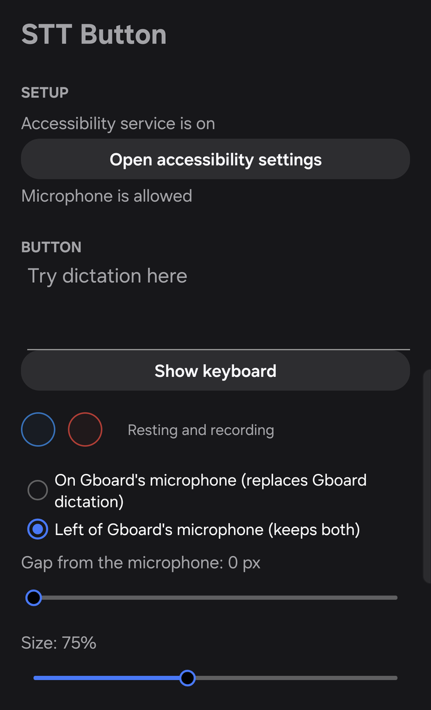
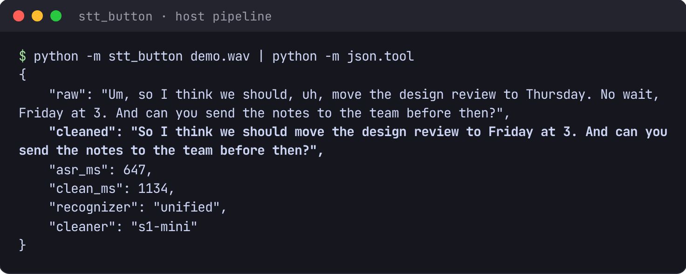
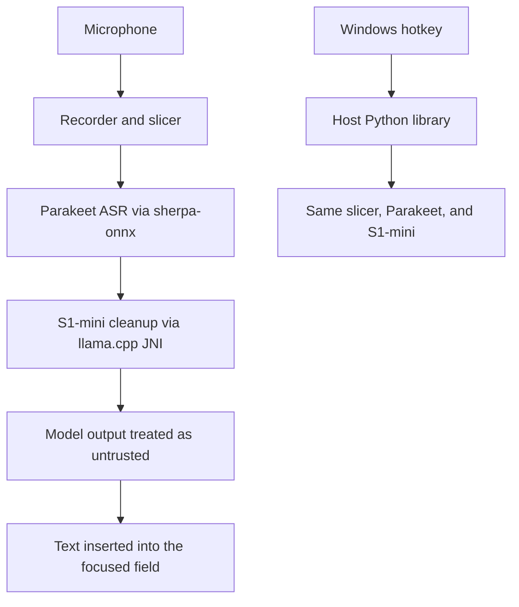

# stt_button

On-device dictation: a button over Gboard's microphone that types into the focused field.

While the keyboard is in English, the button covers that microphone, records on the phone, and inserts the text into whatever field is focused. The manifest removes `INTERNET` with `tools:node="remove"` (`android/app/src/main/AndroidManifest.xml`), so a dependency cannot add a network permission, and model files are copied on with adb. Any other keyboard language leaves the microphone uncovered, so Gboard's own voice typing still receives the tap.

The long version is `docs/design.md`.

## Screenshots

<table>
  <tr>
    <td width="30%"></td>
    <td width="70%" valign="top"><br><br>
      <b>Host pipeline</b> (right). The same slicer, Parakeet recognizer and S1-mini cleaner run on a wav, here synthesized speech. Fillers are dropped and the spoken correction "Thursday. No wait, Friday" is resolved, in 647 ms to recognise and 1.1 s to clean on this machine.<br><br>
      <b>Phone app</b> (left). Setup status, then where the button sits relative to Gboard's microphone, its size, opacity and colours. Recording, recognition and cleanup all run on the phone.</td>
  </tr>
</table>

## Pipeline



A take is 16 kHz mono PCM, at most five minutes (`take_cap_s` in `config/pipeline.json`). The recognizer is Parakeet Unified EN 0.6B, int8, through sherpa-onnx. The cleaner is S1-mini Q4_K_M through llama.cpp; on the phone that call is JNI (`android/app/src/main/cpp/cleaner_jni.cpp`). A streaming FastConformer draws the preview bubble and is not what gets inserted.

The host library in `stt_button/` runs the same slicer, recognizer, and cleaner on a wav, so a model choice can be heard on this machine before anything is installed. Its cleaner is llama.cpp in-process (`Cleaner` in `stt_button/cleaner.py`). On Windows, `desktop/SttHotkey.cs` owns the hotkey (Ctrl+Alt+Space to take, again to paste, Ctrl+Alt+Shift+Space to cancel), the microphone, and the paste. `python -m stt_button.dictate` follows the growing recording through the same slicer and chunking; it cleans with the same GGUF on the local Ollama server and falls back to the in-process backend when Ollama does not answer.

## Design decisions

**One pipeline file, hashes for the weights.** `config/pipeline.json` holds the system prompt, the control line, the take cap, the slice length, the pause rule, the cleaner's chunk sizes, and the skip rule. The Python library reads it, and the Android build packages `config/` as an asset. `config/models.json` pins every download URL and sha256. The two runtimes then share one policy, and a weight change is a hash you can diff. The trade-off is that a clone has no weights: set `STT_MODEL_DIR` and run `scripts/fetch_models.py`. A missing file is an error. The app cannot download one.

**One vector file for Python and Kotlin.** `tests/make_vectors.py` writes `tests/fixtures/pipeline_vectors.json` from the Python implementation, using a Lehmer generator so both languages build the same samples. `tests/test_vectors.py` checks the file still matches the generator. The Android unit tests load that JSON as a resource (`android/app/build.gradle.kts` points the test source set at `tests/fixtures`). Slicing, chunk joins, spoken punctuation, and the untrusted-output rules have one specification. A behavior change updates the generator, and both suites follow it.

**Model text is untrusted.** Both models are downloaded weights. `strip_hidden` drops characters a reader cannot see. `untrusted_clean` in `stt_button/cleaner.py` rejects a cleaned chunk that still contains those characters, chat-template text (`<|`, `|>`, `<think>`), a link whose letters and digits were not spoken, or a name or number that drifted to a near spelling. On a live take the phone (`TakeEngine`) and the desktop worker (`LiveTake._keep`) replace that chunk with the text as heard. The prompt is tokenized so a transcript that spells a special token stays in the user turn. The trade-off is a lost cleanup on that chunk, which is the point: dictation is often handed to an assistant or a messenger that previews links.

**Batch on a file, live chunks on a take.** `run` slices a wav with `Slicer.from_config` (at most `slice_max_s`, 30 seconds, earlier on a pause), recognizes each slice on its own, then `Cleaner.clean` chunks the transcript with `live_chunks`. A phone take and a desktop take under `dictate` do the work while the take is open. Each slice is recognized as it closes. A slice after a pause is decoded with `context_s` (4 seconds) of the speech before it, so the recognizer hears the sentence break, and each closed chunk is cleaned as it lands. A phone take that is writing into a field it can read whole uses `Slicer.fromConfigForField` instead, whose hard cut is `field_slice_max_s` (8 seconds). Chunks are whole sentences and close at `chunk_min_tokens` (128); the last sentence waits for the next slice. Parakeet is not run as a stream. sherpa-onnx's streaming Unified recomputes a long left context per chunk and runs slower than real time, so the preview model is a separate, less accurate streaming recognizer. Cleaning during the take means the stop does not wait on the whole transcript. A chunk cannot see the sentences after it, so a self-correction cue is pulled into its own chunk with the sentence before it. A take of `skip_max_words` (40) or fewer skips the cleaner unless it contains one of those cues.

**One worker, and the cleaner does not outrun its cores.** Slices and chunk cleans run one at a time, in order. On the phone, decoding both models at once made the cleaner several times slower, and giving llama.cpp more threads than the cores the process is allowed makes its workers spin at a barrier. `fit_threads_to_cores` in `cleaner_jni.cpp` sizes a persistent pool to `min(wanted, sched_getaffinity)` at the start of each generation. The trade-off is that a slice waits behind a clean. Prompt-lookup decoding is phone-only; it speeds a cleaner that mostly copies the transcript, and a near-tie can come out different from the host's plain decode.

## Build and run

Python 3.12. From the repo root:

```sh
python -m venv .venv
. .venv/bin/activate
pip install --require-hashes -r requirements.txt
```

Weights go outside the repo. `STT_MODEL_DIR` points at that directory; `scripts/fetch_models.py` fills it and checks the hashes in `config/models.json`.

```sh
python -m pytest -q -m "not slow"
python -m stt_button path/to.wav
python -m stt_button.record --mode ramble
python -m stt_button.dictate watch /path/to/takes
```

`python -m stt_button` prints one JSON object with the raw text, the cleaned text, both timings, and the model names. `record` writes a take under `data/recordings/`. The desktop helper is built on Windows by `desktop/install.sh`, which compiles `desktop/SttHotkey.cs` with the `csc.exe` that ships with Windows and installs the WSL watcher.

The Android app is `android/`, package `com.ezhou.sttbutton`, minSdk 33, targetSdk 36. It needs an Android SDK and JDK 17. `./gradlew` is the build:

```sh
cd android
./gradlew assembleDebug
./gradlew testDebugUnitTest
```

`android/fetch_native.sh` downloads the sherpa-onnx v1.13.8 arm64 libraries (gitignored). `android/push_models.sh` copies the three phone models onto the device. The llama.cpp sources are the `android/third_party/llama.cpp` submodule.

## Tests

`python -m pytest -q -m "not slow"` is the default run. It does not need model files. It covers slicing, spoken punctuation, chunking, the untrusted-output rules, the shared vectors, the dictation file protocol, and the bubble. Tests marked `slow` call the models and skip when `STT_MODEL_DIR` is unset (`pyproject.toml`).

`cd android && ./gradlew testDebugUnitTest` runs the JVM unit tests, including the same `pipeline_vectors.json` the Python suite checks. They do not load the recognizer or the cleaner.

## License

The project's own code is MIT, Copyright (c) 2026 Ethan Zhou. See `LICENSE`.

The vendored sherpa-onnx Kotlin stays Apache-2.0, and the llama.cpp submodule stays MIT. Model licenses, including the S1-mini naming clause, are in `THIRD_PARTY.md`.
